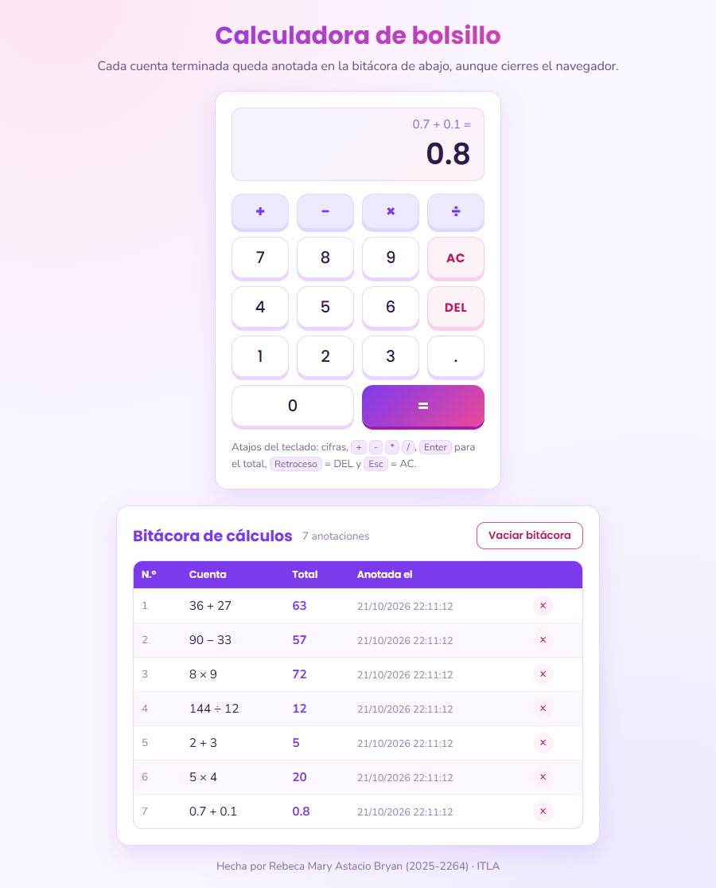
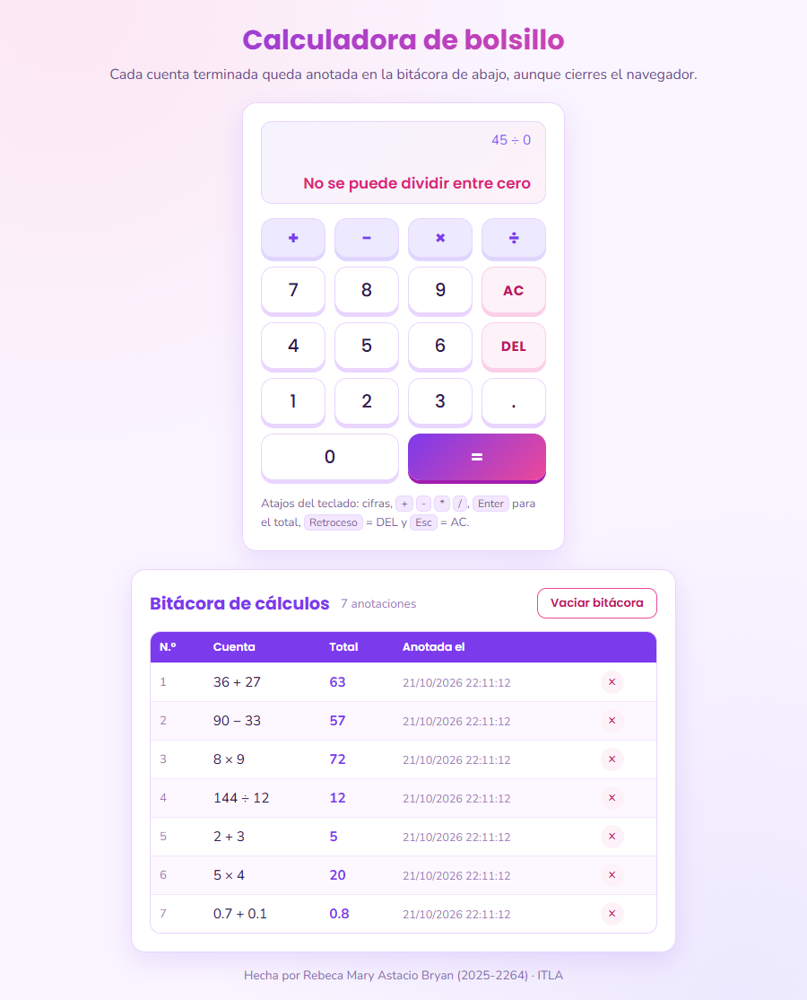
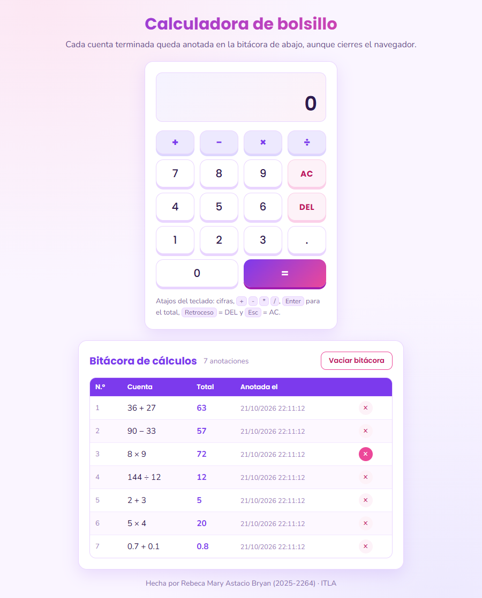
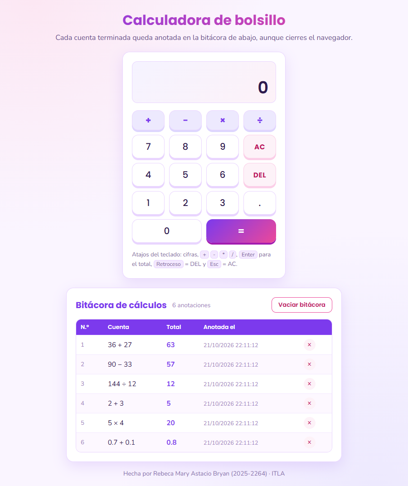
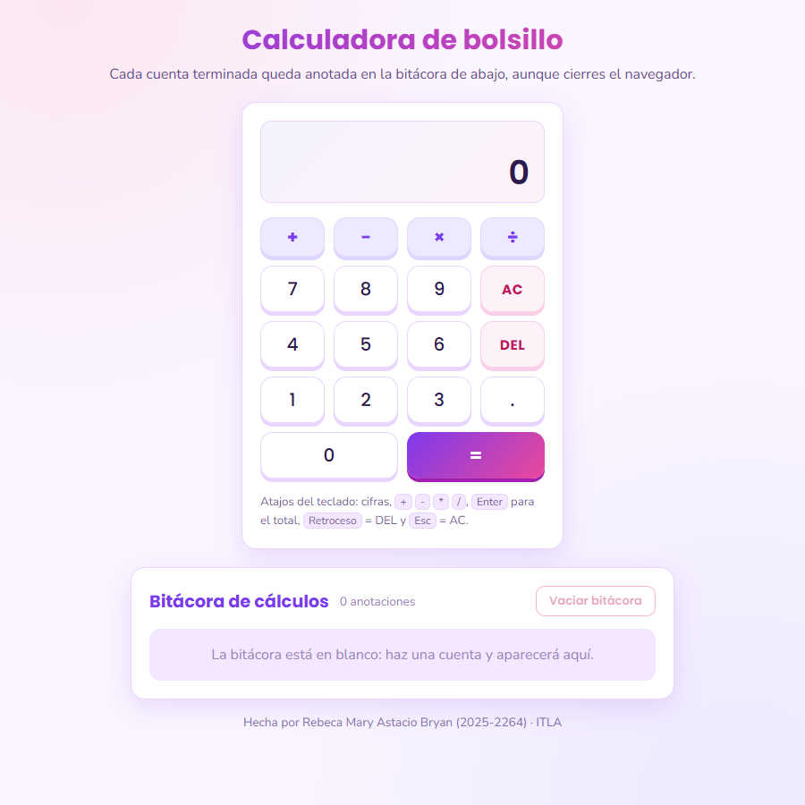

# Calculadora de bolsillo con bitácora (Tarea 2)

| | |
|---|---|
| Autora | Rebeca Mary Astacio Bryan |
| Matrícula | 2025-2264 |
| Asignatura | Programación Web · ITLA · 2026-C-003 |

Una calculadora de bolsillo para el navegador, escrita con **HTML5**, **CSS3** y **JavaScript ES5**. Sabe sumar, restar, multiplicar y dividir. Cada cuenta que se termina se apunta en una **bitácora** (el historial que pide la tarea) con su número de orden, el total y el momento exacto. La bitácora vive en `localStorage`, así que sigue ahí al recargar o al volver otro día, y solo desaparece cuando la usuaria quita anotaciones o la vacía.

## Evidencias



Se hicieron estas cuentas con el ratón: `36 + 27`, `90 − 33`, `8 × 9`, `144 ÷ 12`, `2 + 3 × 4` y `0.7 + 0.1`. La cuenta encadenada `2 + 3 × 4` deja dos anotaciones (`2 + 3` y `5 × 4`) y `0.7 + 0.1` sale `0.8` gracias al redondeo. La bitácora va en orden de llegada: la primera cuenta es la N.º 1.



Con `45 ÷ 0` el visor avisa *No se puede dividir entre cero* y la bitácora sigue en 7 anotaciones: las cuentas que fallan no se apuntan.



Cada fila tiene su botón **×** (se pone rosa al pasar el ratón). Aquí se va a quitar la anotación 3, `8 × 9 = 72`.



Tras quitar esa fila se recargó la página. El visor vuelve a `0`, pero las 6 anotaciones que quedaban se leen de nuevo desde `localStorage`, ya renumeradas y sin la que se quitó.



Con **Vaciar bitácora** (arriba a la derecha de la bitácora) el navegador pregunta cuántas anotaciones se van a borrar. Al aceptar, la tabla desaparece, el botón queda gris y la clave `calcRebeca.bitacora` se elimina de `localStorage`.

## Requisitos de la tarea

| Se pidió | Cómo lo resolví |
|---|---|
| HTML5 | `index.html` con `header`, `main`, `section`, `table` y `footer`; los botones llevan `data-accion` y `data-valor`. |
| CSS3 | `css/estilos.css` con variables, `grid` para la botonera, `flex` para la columna, degradados, sombras, encabezado fijo (`sticky`) en la tabla y una vista para celular. |
| JavaScript ES5 | `js/calculadora.js` solo usa `var` y `function`: nada de `let`, `const`, flechas, clases ni plantillas. |
| Las cuatro operaciones | Fila de signos `+ − × ÷` encima de los números. |
| Guardar los cálculos hasta que se eliminen | Bitácora en una tabla debajo de la calculadora. Se puede quitar una anotación con su **×** o todas con **Vaciar bitácora** (pide confirmación). |
| `localStorage` | Arreglo JSON en la clave `calcRebeca.bitacora`; cada anotación guarda `cuenta`, `valor` y `cuando`. Si la bitácora queda vacía, la clave se borra. |

## Así funciona

Igual que una calculadora de mano: se escribe un número, se elige un signo y se escribe el segundo número. La cuenta se cierra al pulsar **=** o al elegir otro signo; en ese momento se calcula, se muestra el total y se apunta en la bitácora. Mientras se espera el segundo número, el signo elegido queda encendido en violeta.

El visor tiene dos renglones: el de arriba, pequeño, enseña la cuenta (`36 +` o `36 + 27 =`) y el de abajo, grande, el número que se escribe o el total.

Algunos detalles:

- **Sin jerarquía de operaciones:** cada cuenta se cierra en el acto, como en las calculadoras de bolsillo. Por eso `2 + 3 × 4` da `20`.
- **Redondeo:** el total se pasa por `toPrecision(12)`, así `0.7 + 0.1` da `0.8` y no `0.7999999999999999`. Cada número admite un solo punto y hasta 15 cifras.
- **Teclas AC y DEL:** **AC** pone todo a cero y **DEL** quita la última cifra que se escribió.
- **Teclado físico:** cifras, `.` o `,`, `+ - * /`, `Enter` o `=` para el total, `Retroceso` hace de DEL y `Esc` de AC. Cada tecla física hunde por un instante su botón dibujado.
- **Después de un error** basta con pulsar una cifra o **AC** para seguir.

## Abrirla

Doble clic en `index.html`; no hay nada que instalar. Si se prefiere un servidor local:

```bash
python -m http.server 8000
```

y luego visitar `http://localhost:8000`.

## Archivos

```
Tarea2-Calculadora/
├── index.html           visor, botonera y bitácora
├── css/estilos.css      colores lila y rosa, botones con relieve, tabla y vista móvil
├── js/calculadora.js    cuentas, visor y bitácora en localStorage
└── evidencias/          imágenes que se ven en este README
```

Las partes de `calculadora.js`:

- **Botones:** `teclearCifra`, `fijarSigno`, `pedirTotal`, `quitarCifra` y `todoACero`; `despachar` decide cuál llamar.
- **Aritmética:** `cerrarCuenta`, `aplicar` y `pulir` (redondeo).
- **Bitácora:** `leerBitacora`, `escribirBitacora`, `anotar`, `quitarAnotacion`, `vaciarBitacora` y `dibujarBitacora`.
- **Eventos:** `clicEnBotonera`, `clicEnBitacora` y `teclaFisica`.
