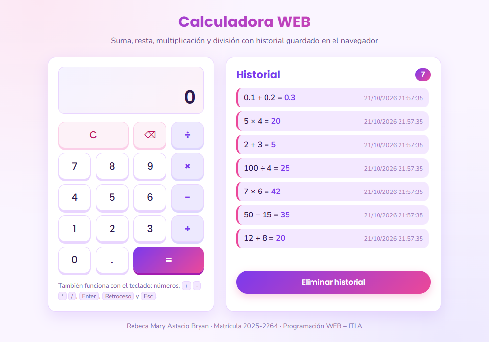
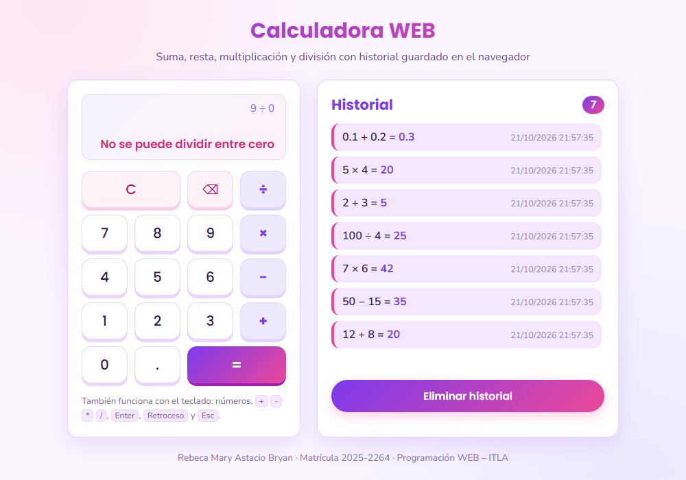
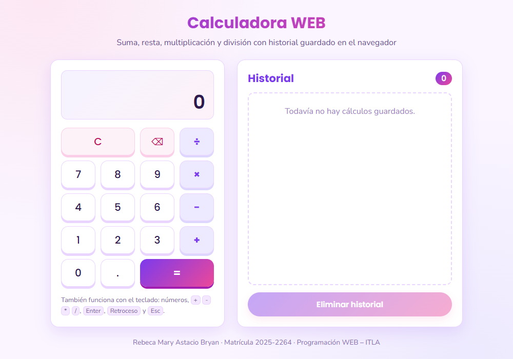

# Tarea 2 – Calculadora WEB con historial

**Estudiante:** Rebeca Mary Astacio Bryan · **Matrícula:** 2025-2264

Programación WEB – ITLA (2026-C-003)

## ¿Qué hace?

Es una calculadora de bolsillo hecha con **HTML5**, **JavaScript ES5** y **CSS3**. Hace sumas, restas, multiplicaciones y divisiones, y cada cálculo terminado se anota en un historial con su fecha y hora. El historial se queda guardado en el navegador aunque se cierre o recargue la página, hasta que el usuario decida borrarlo.

## Cómo cumple cada requisito

| Requisito | Dónde se ve |
|---|---|
| HTML5 | `index.html` usa etiquetas semánticas (`header`, `main`, `section`, `footer`) y botones con atributos `data-accion` / `data-valor`. |
| JavaScript ES5 | `js/calculadora.js` usa solo `var` y `function` (sin `let`, `const`, funciones flecha, clases ni plantillas de texto). |
| CSS3 | `css/estilos.css`: variables CSS, `grid` para el teclado, `flex` para las tarjetas, degradados, sombras y transiciones. |
| Suma, resta, multiplicación y división | Teclas `+`, `−`, `×` y `÷`. |
| Historial hasta que el usuario lo elimine | Lista a la derecha (el más reciente arriba) y botón **Eliminar historial**, que pide confirmación con `confirm()`. |
| Uso de `localStorage` | El historial se guarda como JSON en la clave `rebeca_historial`. Cada entrada tiene `operacion`, `resultado` y `fecha`. |

## Cómo funciona por dentro

La calculadora trabaja como una **máquina de estados**, igual que las calculadoras físicas:

1. Se escribe el **operando A**.
2. Se elige un **operador** (la tecla queda resaltada en violeta mientras espera).
3. Se escribe el **operando B**.
4. Al pulsar **=**, o al elegir otro operador, se resuelve `A operador B` y el resultado pasa a ser el nuevo número.

La pantalla tiene dos líneas: arriba se ve la operación en curso (por ejemplo `12 +` o `12 + 8 =`) y abajo el número que se está escribiendo o el resultado.

Detalles a tener en cuenta:

- **Operaciones encadenadas:** como cada operación se resuelve al momento, `2 + 3 × 4` da **20** (primero `2 + 3 = 5` y después `5 × 4 = 20`). Así se comportan las calculadoras clásicas de bolsillo, que no aplican la jerarquía de operaciones. En el historial quedan los dos pasos.
- **Decimales:** los resultados se redondean a 12 cifras significativas, por eso `0.1 + 0.2` muestra `0.3` y no `0.30000000000000004`. Solo se permite un punto por número.
- **División entre cero:** aparece el mensaje *No se puede dividir entre cero* y ese cálculo **no** se guarda en el historial. Al pulsar una cifra o **C** la calculadora vuelve a empezar.
- **Teclado físico:** dígitos, `.` o `,`, `+ - * /`, `Enter` o `=` para el resultado, `Retroceso` para borrar la última cifra y `Esc` para limpiar. La tecla correspondiente se hunde en pantalla al usarla.
- Si se pulsa un operador justo después de un resultado, se sigue operando con ese resultado.

## Cómo ejecutarlo

No necesita instalar nada. Basta con abrir `index.html` en cualquier navegador moderno (doble clic).

También se puede servir con un servidor local, por ejemplo:

```bash
python -m http.server 8000
```

y entrar a `http://localhost:8000`.

## Estructura de archivos

```
Tarea2-Calculadora/
├── index.html          estructura de la página (pantalla, teclado e historial)
├── css/
│   └── estilos.css     diseño lila/rosa, efecto de pulsación y vista para celular
├── js/
│   └── calculadora.js  lógica de la calculadora y manejo del historial
└── capturas/           imágenes usadas en este README
```

Funciones principales de `calculadora.js`:

- `escribirDigito`, `elegirOperador`, `calcularResultado`, `borrarUltimo`, `reiniciar`: acciones de las teclas.
- `resolver` y `operar`: hacen el cálculo de `A operador B` y detectan la división entre cero.
- `cargarHistorial`, `guardarHistorial`, `agregarAlHistorial`, `eliminarHistorial`, `pintarHistorial`: todo lo relacionado con `localStorage` y la lista.
- `alHacerClic` y `alTeclear`: reciben los clics del ratón y las teclas del teclado.

## Capturas de pantalla


Después de hacer con clics `12 + 8`, `50 − 15`, `7 × 6`, `100 ÷ 4`, `2 + 3 × 4` y `0.1 + 0.2`. La pantalla muestra `0.1 + 0.2 =` arriba y `0.3` abajo; el historial lista cada cálculo con su fecha y hora.



La misma página después de recargarla: la pantalla vuelve a `0`, pero los 7 cálculos siguen en el historial porque se leyeron de `localStorage`.



Al intentar `9 ÷ 0` aparece el mensaje de error en rosa y el contador del historial se queda en 7: el cálculo fallido no se guardó.



Después de pulsar **Eliminar historial** y aceptar la confirmación: la lista queda vacía, el contador marca 0, el botón se desactiva y la clave `rebeca_historial` desaparece de `localStorage`.
